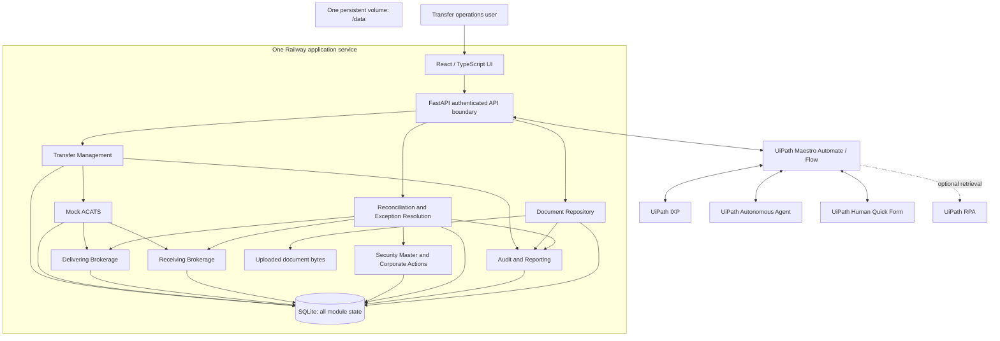

# TransferIQ AI Architecture

## Scope and status

Railway backend preparation now supplies Railpack configuration at repository root, `python -m backend.start`, and a single service/worker/replica using one `/data` volume. Startup validates the mounted volume and production secret, initializes/migrates SQLite, recovers pending documents, optionally adds missing fictional fixtures/PDFs (`SEED_DEMO_DATA=1`), then enables `/health` readiness. Existing data and document IDs are preserved; migration failures stop startup. JSON console logging omits raw exception details and credentials. Local verification passed 243 tests; cloud deployment and volume acceptance remain unperformed. See [deployment guide](docs/RAILWAY_DEPLOYMENT.md).

Step 5 adds a manually triggered Maestro Automate Flow artifact, locally validated but not deployed or cloud-executed. It calls the concrete `/api` transfer, source-position, transfer-filtered receiving-staging and reconciliation endpoints. Normalization maps `summary.unresolved` to `unresolvedCount`; the decision separates quantity CLEAN from INVESTIGATION_REQUIRED with independent cost-basis review flags. Errors produce FAILED; no financial calculation or correction occurs in JavaScript. Secure HTTP connection binding and hosted HTTPS reachability remain prerequisites. See [Step 5 setup](docs/MAESTRO_STEP5_SETUP.md). Broader IXP/agent/approval orchestration below remains planned.

Step 4 implements the private PDF document repository and deterministic generation from stored fictional records. SQLite schema v3 adds TransferDocument metadata; bytes live under DATA_DIR/documents in generated transfer buckets. All document routes require X-API-Key. Pending writes recover on startup, and downloads verify size and checksum before returning actual PDF bytes. See [DOCUMENT_API.md](docs/DOCUMENT_API.md) for storage/versioning/validation details and [IXP_INTEGRATION_PLAN.md](docs/IXP_INTEGRATION_PLAN.md) for the unimplemented future file handoff.

Step 3 implements deterministic reconciliation independently of AI, an additive SQLite v2 migration, verified synthetic reference tables, exact split/identifier comparison, separate cost-basis checks, and persisted fingerprinted results. All seven new reconciliation/reference endpoints require X-API-Key, including exception reads. See [the detailed rules and contract](docs/RECONCILIATION.md). No quantities or lifecycle states are automatically corrected.

Step 2 implements the local FastAPI/SQLite foundation, core reference and transfer APIs, immutable custody snapshots, receiving staging records, explicit demo seeding, and atomic transfer-creation audit/idempotency records. Step 4 document IDs use a DOC- prefix plus UUID; each immutable document version has its own ID. The broader architecture below remains planned unless identified as implemented here. UiPath tenant availability, authentication scopes, resource identifiers, and concrete invocation contracts must be verified during integration implementation. No successful integrations are claimed.

### Step 2 decisions that supersede the initial foundation

- The database filename is `transferiq.db`, as requested for Step 2.
- Implemented routes use `/api`, exactly as requested; `/api/v1` remains a future versioning decision.
- API keys protect mutations through `X-API-Key` and `API_KEY`. Existing Step 2 GET endpoints expose fictional demonstration data without authentication; Step 3 reconciliation and evidence GET endpoints require the key. Reviewer sessions and resource-level access control are not implemented.
- New transfer creation records intent only, starts in DRAFT, and does not generate positions, perform ACATS processing, submit, settle, or alter source records. PARTIAL is metadata only until later asset-selection rules exist.
- `/api/transfers/{transferId}/assets` returns receiving staging positions. Receiving account positions are transfer-specific staging rows, never settled or aggregated custody holdings. Delivering positions return the latest snapshot date for that account.
- Status transitions are validated by a service validator and SQLite triggers; no status-mutation API is exposed. The initial graph is listed below. Business gates for approvals and reconciliation are deferred.
- Decimal quantities use exact TEXT storage with 18 integer and 8 fractional digits; excess precision is rejected rather than silently rounded. UTC-aware timestamps are stored as ISO 8601 text and returned with UTC offsets.
- `PRAGMA user_version=3` marks the current schema; an additive transactional migration upgrades version 1 without modifying original record values. Existing unversioned or unsupported databases are rejected, never reset or silently adopted. Future revisions require ordered migrations; `create_all` is used only for an empty version-zero database.
- Audit events and optional idempotency records commit with transfer creation. Reuse an `Idempotency-Key` for retry-safe creation; omitted keys create distinct requests. The key scope is the single API service principal and sole mutation operation in Step 2. Outbox dispatch and external calls are not implemented.
- Seed IDs such as `TRF-1001` are fixed fictional fixtures; API-created transfer IDs use a `TRF-` prefix plus a UUID.

The system simulates transfer exception resolution using fictional data only. Eight logical systems share one FastAPI application and SQLite database; they are module boundaries, not separate cloud services. No PostgreSQL, MySQL, MongoDB, Redis, external database server, trading connection, or real ACATS connection is permitted.

## Architecture diagram



FastAPI will serve the compiled frontend in cloud deployment; Vite can run separately during local development. All module writes use the shared database transaction layer. UiPath receives only authorized evidence through the API, never filesystem paths or database access.

## Component responsibilities

| Logical system | Responsibility and boundary |
|---|---|
| Transfer Management System | Own transfer identity, fictional account references, lifecycle state, document requirements, correlation to Maestro runs, and allowed transitions. |
| Mock ACATS System | Simulate submission, validation, processing, exceptions, and completion with reproducible scenarios. Never connect to real transfer infrastructure. |
| Delivering Brokerage System | Provide immutable original mock custody positions, dated snapshots, and fictional source statements. Corrections never overwrite source holdings. |
| Receiving Brokerage System | Hold expected and simulated received positions and separately versioned adjustment records. Represent only simulated outcomes. |
| Security Master and Corporate Actions Service | Provide fictional identifiers, effective-dated identifier mappings and corporate-action evidence. Ambiguous mappings require review. |
| Document Repository | Store authorized uploads, hashes, metadata, ownership, versions, and extraction references; stream bytes through access-controlled APIs. |
| Reconciliation and Exception Resolution Engine | Compare normalized snapshots, classify exceptions, validate recommendations, apply permitted adjustments, and rerun reconciliation. Own deterministic correction policy. |
| Audit and Reporting Service | Persist append-only events, actor identity, evidence references, decisions, state transitions, and operation correlation; provide authorized reporting. |

`backend/api/` owns routers and HTTP dependencies; `backend/models/` owns database entities; `backend/schemas/` owns Pydantic contracts; `backend/core/` owns configuration; `backend/services/` owns implemented transfer validation and planned business logic/adapters; `backend/database/` owns engine/session configuration, transactions, schema versions, and migrations. Split submodules incrementally as needed.

## End-to-end process

1. An authenticated receiving-firm operator creates a fictional transfer request. Transfer Management assigns a `transferId` and records its initial state and audit event.
2. The operator attaches fictional statements and transfer records. Each accepted document receives a `documentId` linked to the transfer. Optional RPA may retrieve documents from a mock source through the same ingestion boundary.
3. Mock ACATS simulates processing against immutable delivering custody snapshots and receiving expectations. Reconciliation identifies quantity mismatches, missing securities, identifier changes, corporate-action timing differences, missing cost basis, and unsupported or incomplete records.
4. A persisted orchestration request starts Maestro investigation. Maestro retrieves authorized transfer context and document evidence, invokes IXP, and returns correlated extraction results. Low-confidence, incomplete, or contradictory extraction stays unresolved pending review; extracted text is evidence, not authoritative instruction.
5. The Autonomous Agent investigates using evidence, security mappings, and corporate actions. It returns a structured recommendation with evidence references and uncertainty. It cannot authorize or directly apply financial changes.
6. The backend validates the recommendation against deterministic policy. Human Quick Form collects approval or rejection where required. Default policy is no automatic correction until an explicit, tested allowlist exists; missing cost basis is never invented, and unsupported records remain held for review.
7. The backend verifies the decision and current proposal version, applies an authorized adjustment in a transaction, and reconciles again. Original custody snapshots remain unchanged. Failed reconciliation remains open; approval alone never marks a transfer successful.
8. Final simulated completion or rejection and all intermediate decisions remain available in audit history.

Step 2 lifecycle: DRAFT -> SUBMITTED -> UNDER_REVIEW. UNDER_REVIEW permits EXCEPTION_DETECTED, RESOLVED, or ESCALATED. EXCEPTION_DETECTED permits INVESTIGATING or ESCALATED. INVESTIGATING permits PENDING_APPROVAL, RESOLVED, or ESCALATED. PENDING_APPROVAL permits RESOLVED or ESCALATED. ESCALATED permits UNDER_REVIEW. RESOLVED permits COMPLETED. COMPLETED is terminal. No arbitrary status updates are accepted. These are structural transitions, not implemented approval or reconciliation controls; no status-changing API exists yet. Technical retry state is distinct from business outcome.

## Identifiers and evidence relationships

- `transferId`: backend-generated opaque UUID, stable for the entire transfer; internal and public correlation key, never a credential. One transfer has many documents, exceptions, audit events, and investigation attempts.
- `documentId`: backend-generated opaque UUID identifying one immutable document version. Each document belongs to exactly one transfer in the initial design, enforced by a non-null foreign key. Re-uploaded or corrected evidence gets a new ID and may reference the prior version through `supersedesDocumentId`.
- Document metadata includes transfer ownership, document type, generated storage key, SHA-256 hash, original display filename, size, MIME type, creation time, and ingestion status. Physical paths are not exposed as API identifiers.
- Extraction attempts reference `documentId`, `transferId`, provider job/run ID, extractor version, extracted fields, confidence when supplied, and status. Repeated extraction does not replace source bytes or prior results.
- Exceptions, recommendations, approvals, and adjustments reference their transfer and exact evidence/proposal versions. Backend validation rejects cross-transfer document references even if IDs are otherwise valid.
- Maestro run IDs and external task/job IDs are stored separately from `transferId`. Multiple attempts may concern one transfer; callbacks must match the stored attempt and expected state.

## UiPath and API interaction contract

Design versioned JSON APIs under `/api/v1` with Pydantic validation and generated OpenAPI documentation suitable for Maestro HTTP calls. Concrete routes are deferred. Use explicit states, UTC timestamps, decimal strings, stable error codes, correlation IDs, and paginated collections. Long-running operations return an accepted operation identifier and expose persisted status; acceptance must not be reported as completed work.

The backend initiates Maestro through a future verified adapter. Maestro calls authenticated backend APIs to retrieve scoped context, return IXP evidence and agent recommendations, and relay decisions. Exact UiPath endpoints, supported document transport, polling/callback mechanism, and Quick Form decision verification must be established against the actual tenant and official contracts before implementation. A missing integration produces a clear unavailable/configuration error, never fabricated success.

Use separate backend service credentials and UiPath OAuth configuration. Persist operation intent before external dispatch (a SQLite outbox), store remote correlation once acknowledged, and reconcile ambiguous timeouts before resubmission. Do not hold database transactions open across network calls. Bounded retries, timeouts, durable attempt counts, and manual recovery handle failures. An in-process dispatcher can service the SQLite outbox without Redis or an additional hosted worker service.

Require idempotency keys for retriable mutations. Persist principal, operation scope, key, canonical request hash, status, and result with a uniqueness constraint. Same key and payload returns the recorded outcome; a changed payload conflicts. Deduplicate callbacks by provider event or operation identity and verify sequence/version. Business changes, audit events, and idempotency completion commit together. External side effects cannot share that transaction; outbox recovery and provider correlation address that boundary.

## SQLite and document persistence

Resolve `DATA_DIR` to an absolute path once at startup: default `./data` relative to the repository root locally, `/data` in Railway. Derive the SQLAlchemy SQLite connection URL safely from `DATA_DIR/transferiq.db`; do not build platform-dependent URLs by string concatenation. Create directories when appropriate and fail clearly if the configured storage is unwritable. Never silently fall back to ephemeral storage in cloud.

Runtime layout (document and staging directories are now implemented):

```text
DATA_DIR/
|-- transferiq.db
|-- transferiq.db-wal   # SQLite-managed when WAL is active
|-- transferiq.db-shm   # SQLite-managed when WAL is active
|-- documents/              # Generated storage keys, never user paths
|-- staging/                # Incomplete uploads awaiting finalization
|-- tmp/                    # Multipart spool files
|-- sample_exports/         # Optional explicit developer seed exports
`-- verification/           # Optional developer checks and visual QA
```

Use SQLAlchemy sessions per request/unit of work, foreign-key enforcement on every connection, WAL mode, a bounded busy timeout, short transactions, and optimistic version checks. SQLite serializes writers; use one application replica and one worker initially. Test filesystem support for WAL on the mounted volume and validate restart behavior before deployment. Do not add replicas sharing the database file.

Persist transfers, immutable custody snapshots, receiving records, security mappings, corporate actions, document metadata, extraction attempts, exceptions, recommendations, approvals, adjustments, audit events, idempotency records, and outbox operations. Version schema migrations and test upgrades; startup must not recreate or drop existing data.

Use Python `Decimal` with explicit scales and rounding policies for quantities, cost basis, and monetary values. Store exact values as validated canonical decimal text or explicitly scaled integers; do not rely on SQLite floating-point arithmetic for financial calculations. Missing values remain unknown, distinct from zero. Effective dates, policy versions, and evidence determine reconciliation; tolerance and corporate-action rules require explicit specification before implementation.

Database transactions and filesystem writes are not atomic together. Stage and hash uploads, persist pending metadata, atomically move bytes within the volume, then mark ready; recovery handles interrupted moves and orphan staging files. Never serve incomplete documents. Backups must use SQLite-consistent backup procedures and a coordinated document manifest, followed by restore verification; raw copying an active database alone is insufficient. A persistent volume is not a backup. Backup retention and export destination must be selected before deployment without adding an unapproved service.

## Security, approvals, and audit

Authenticate all business APIs and authorize access to each transfer and document. Service bearer credentials must map to bounded roles; browser bundles must never contain service tokens or UiPath secrets. Implement operator/reviewer sessions separately with secure, HTTP-only cookies and CSRF protection for cookie-authenticated writes. Configure exact local origins if Vite runs separately; cloud should use same-origin hosting.

Documents are private: validate file size/type, sanitize display filenames, generate storage keys, reject path traversal, and stream through authorization checks. If UiPath requires a download link, use short-lived, narrowly scoped access and redact credentials from logs. Treat uploaded text and agent output as untrusted data, including instructions embedded in statements.

An approval is a persisted decision tied to an authenticated authorized reviewer, transfer, exception, proposal version/hash, evidence version, expiry, outcome, and reason. A posted `approved=true` or reviewer name is not proof of approval. Verify the UiPath task and trusted decision identity through the supported integration; fail closed until this is possible. Prevent unauthorized self-approval, stale proposals, replay, double application, and approval after expiry. Revalidate policy and state at application time; changed proposals require a new approval.

Original custody records must have application-level update/delete denial plus database protections and regression tests. Store all changes as separate versioned adjustment records. Audit events are append-only through application interfaces and commit with business writes, recording actor, action, time, correlation, prior/new state, reason, and evidence. This is persistent history, not a claim of cryptographic tamper-proof storage against a database administrator. Never log secrets or entire document contents.

## Deployment and unresolved decisions

One Railway application service serves FastAPI and the compiled frontend; one persistent volume stores SQLite and documents at `/data`. Runtime dependencies are limited to the chosen stack, deployment platform, and required UiPath services. Validate deployment-specific settings when implementing them; no Railway resources exist yet.

Before the relevant implementation phases, specify correction allowlists and tolerances, document schema and confidence policy, reviewer roles and assignment, supported security/corporate-action scenarios, UiPath resource contracts, and backup retention. These are intentionally unresolved business/integration details, not working defaults that permit financial changes.

## Next steps

Steps 1–4 are implemented. Step 5 has a real Flow artifact and local evidence; cloud acceptance remains blocked pending HTTPS hosting and a secure HTTP connection. Follow [PROJECT_PLAN.md](PROJECT_PLAN.md) and [Step 5 setup](docs/MAESTRO_STEP5_SETUP.md) before runtime acceptance or later IXP/agent/approval work.


