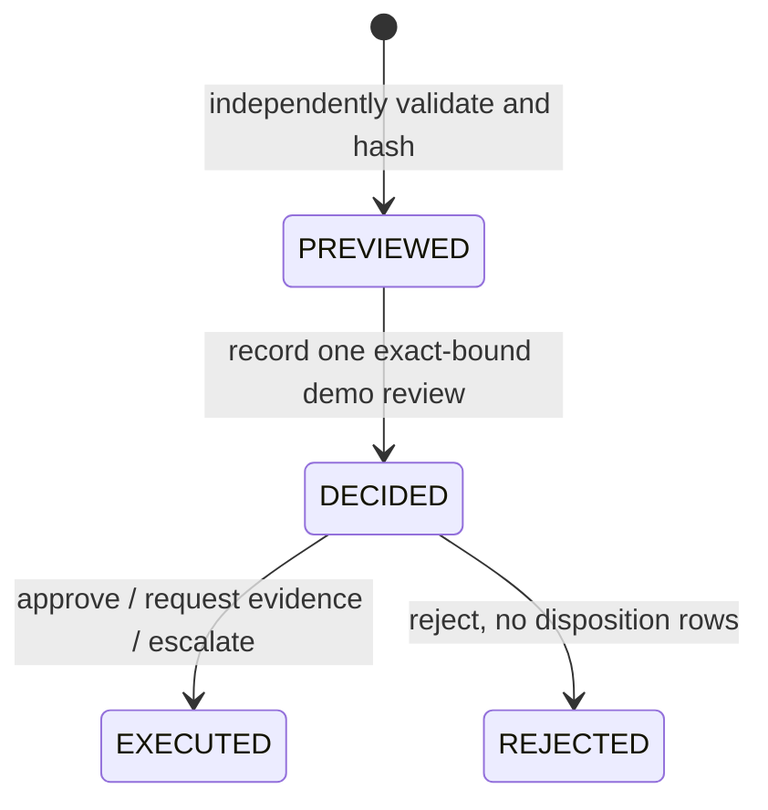

# Step 9 — isolated human review

Implemented locally on 2026-11-06. The real Quick Form node is authored and the compiled Flow passes product validation. **No Step 9 Action Center task or human completion has yet been observed.** Render returned HTTP 404 for the new review-run route. See [actual tests](STEP9_TEST_RESULTS.md) and [API contracts](STEP9_API_CONTRACTS.md).

## Flow and form

The existing Flow ID and Autonomous Agent are preserved. Successful independent agent validation leads to `BuildResolutionPlan`, `PreviewResolutionPlan`, `ValidateResolutionPlan`, then `TransferOperationsReview`. Invalid or incomplete investigations retain the existing evidence-review result. CLEAN bypasses the agent and form. `enableIXP=false` remains the default; Step 9 preview accepts `NOT_PROCESSED_IXP_DISABLED`. Enabling IXP retains the existing setup/evidence stops, not a claimed extraction integration.

`TransferOperationsReview` uses the real `uipath.human-in-the-loop.quick-form` definition, version 1.0. It is not a Script or Mock. Recipient channel is Action Center; the assignee is the manual input `reviewerReference`. For debug, supply the currently authenticated UiPath user's email/user ID obtained from `uip login status`, not an invented identity. CLEAN does not require this input. An investigation with a blank reviewer fails before task creation.

| Form fields | Direction |
|---|---|
| Transfer ID, fictional client reference, exception count | Read-only |
| Agent summary, SEC-103 corporate-action facts, SEC-104 shortage facts | Read-only |
| Verified evidence IDs, backend-validated proposed dispositions | Read-only |
| Plan ID/hash, overall risk, demo scope notice | Read-only |
| `reviewerComments`, `additionalInformation` | Editable text, maximum 2,000 characters each downstream |

No editable disposition, quantity, plan binding, or reviewer identity is accepted from the form. The model's summary is labelled untrusted narrative. Displayed exception facts and proposed actions come from backend records, not free-form model text.

| Button / source port | Script | Backend outcome |
|---|---|---|
| Approve Disposition / `outcome-approve-disposition` | `ApproveDisposition` | `APPROVE` |
| Request Evidence / `outcome-request-evidence` | `RequestEvidence` | `REQUEST_EVIDENCE` |
| Escalate / `outcome-escalate` | `EscalateDisposition` | `ESCALATE` |
| Reject / `outcome-reject` | `RejectDisposition` | `REJECT` |

Every branch checks the actual form output's `Action` and reads `reviewerComments`/`additionalInformation` by field ID. The selected branch writes the Flow variable `reviewDecision`. The exact previewed plan version/hash accompany the decision. A correlation string ending in `:TransferOperationsReview` is a **demo event reference, not a verified task ID**. Actual Action Center task identity must be captured separately during the live test.

API and validation failures after investigation return `REVIEW_FAILED`. Quick Form 1.0 has no supported error port; the SDK rejected attaching one. Task-service creation/runtime failures therefore remain native UiPath incidents and do not authorize a disposition. Cancellation, expiry or an unanswered task is not approval.

## State and permitted effects



Each immutable plan is version 1; changed content requires a new plan ID and review. A run permits at most five plans. Decisions and disposition history are append-only. Exact retries return the existing result; different payloads or reused review events conflict. Backend data/evidence fingerprints and the latest reconciliation must still match at decision, execution and verification. The existing demo run expiry applies throughout.

TRF-1002 approval acknowledges SEC-103's independently verified explanation and creates an open escalation for SEC-104. The 20-share shortage stays unresolved. Request Evidence creates evidence-request dispositions; Escalate creates open operations dispositions; Reject creates no disposition records. Missing basis opens a basis case, never a fabricated value. No path changes custody snapshots, staging quantities, underlying reconciliation exceptions or transfer lifecycle status.

After execution, the Flow independently reads the plan, latest reconciliation, verification and audit. It checks the exact decision, hash/version, expected dispositions, unchanged exceptions, quantity verification and all three required audit events. The structured report includes the requested IDs, summary, plan status, review outcome, evidence, dispositions, unresolved exceptions, document status, verification, workflow outcome and scoped audit URL. It explicitly reports `transferCompleted=false`, zero corrections and unverified demo identity.

## Demo security and reproducibility

Run creation automatically issues a strong random, run-scoped `reviewCapability`; judges do not configure a TransferIQ API key or connection. The capability is required for plan/decision/execution writes and expires with the isolated run. Knowing a public plan ID/hash is insufficient. Normal Step 5 run creation cannot be replayed to acquire review authority. Private mutation routes remain protected and fail closed without verified-review configuration.

The backend does not authenticate a UiPath callback or verify the reviewer string. The audit is explicitly `UNVERIFIED_DEMO_REFERENCE` / `demoOnly=true`. A run owner can submit constrained synthetic decisions directly; these are **not evidence of human participation**. Real human participation is established only by the actual UiPath task and resumed execution. Do not use the demo ledger for real approval authority.

Capabilities remain in the private registry and runtime HTTP context. Do not publish raw debug inputs/variables/headers or creation responses; redact `reviewCapability` and `X-Demo-Capability`. Final reports and forms omit them. Demo reads are public to holders of run IDs, so enter fictional/non-sensitive comments only. Quotas, rate limits and one-worker isolation remain enforced. Review writes have zero automatic retries; an operator may resume using the same immutable request after inspecting state.

## Deploy the backend before live testing

This workspace has no `.git` directory (`git rev-parse --show-toplevel` fails). No commit/push or Render redeployment was performed by this task. Copy the reviewed source changes into the existing GitHub checkout connected to Render; do not copy `.env`, `data`, runtime traces, capabilities, caches or tenant-local configuration.

Backend files: `backend/api/resolution.py`, `backend/api/public_limits.py`, `backend/database/migrations.py`, `backend/models/resolution.py`, `backend/models/entities.py`, `backend/schemas/resolution.py`, `backend/services/resolution.py`, `backend/services/demo_runs.py`, `backend/main.py`. Include the Step 9 tests, Flow source/scripts/compiled artifact and documentation when committing the project. Preserve existing `.uipx` via the CLI; do not edit it by hand.

In that checkout:

```powershell
git status --short
git diff --check
# Review/stage the specific changed files; exclude all secrets/runtime data.
git add backend tests scripts/maestro-local-runner.mjs docs/STEP9_HUMAN_APPROVAL.md docs/STEP9_API_CONTRACTS.md docs/STEP9_TEST_RESULTS.md README.md ARCHITECTURE.md PROJECT_PLAN.md
# Stage the reviewed Maestro project source/artifact separately; inspect staged paths.
git diff --cached --stat
git commit -m "Add isolated demo review plans and Maestro Quick Form"
git push
```

In Render, deploy that exact commit on the existing service. Keep the existing `/data` persistent disk, environment and one-worker launcher. Schema v4 is additive; registry v2 adds review capability storage. Startup migrates existing databases without reseeding over prior records. Back up the existing persistent data using the established deployment procedure; never delete/reset it to apply this change. Follow [Render settings](RENDER_DEPLOYMENT.md).

Acceptance after deployment: `/health` must return 200; OpenAPI must contain `/api/demo/runs/review`; a single valid review creation must return 201 (or 200 on exact retry), not 404, and contain the capability without logging its value. Use that run for scoped reconciliation, preview, decision and verification. A malformed review request should be 422. Stop and inspect `Retry-After` on 429; do not launch repeated debug runs to probe readiness.

## Real task completion procedure (pending deployment)

1. Validate the final artifact and refresh solution resources using the installed Flow skill. Debug the existing project with `transferId=TRF-1001`, `enableIXP=false`; confirm CLEAN without a form.
2. Obtain the signed-in UiPath identity with `uip login status --output json`. Debug TRF-1002 with that `reviewerReference` and IXP false. Preserve a sanitized execution ID and locate the actual waiting task. No task ID/link is available yet.
3. In the same UiPath organization/tenant, open **Action Center → My Actions**, filter Pending and search **TransferOperationsReview - TRF-1002**. Match its displayed plan ID/hash with the waiting run before submitting. The assistant must not complete it for the user.
4. Inspect the split evidence and unchanged SEC-104 shortage; optionally enter fictional comments, then choose **Approve Disposition**. Resume/inspect the same instance rather than creating another run. Require `REVIEWED_WITH_OPEN_EXCEPTIONS`, SEC-104 difference `-20`, `VERIFIED_DEMO_STATE` and persisted audit records.
5. Start a separate TRF-1002 run, wait for its distinct task, and have the user select **Reject**. Require `REVIEW_REJECTED` and no disposition rows. Separately run TRF-1004 and TRF-1005 and allow the user to complete their review tasks. Never substitute test-double outputs when reporting these live results.

The assistant will provide the exact task identity/link after observing a real task. Manual completion remains pending; no real approval success is claimed.
